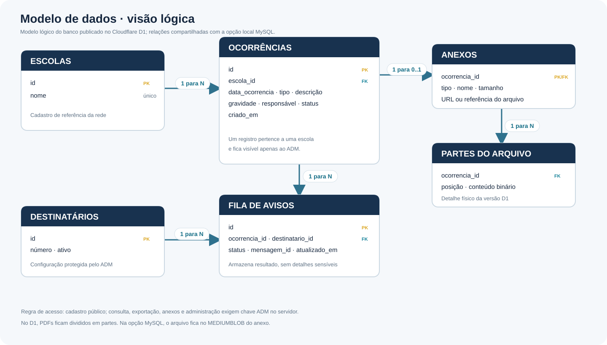

# Conviva SP — apresentação do sistema

**Resumo para apresentação:** aplicação web para registrar ocorrências escolares com contexto, anexos e protocolo. A consulta à rede, aos indicadores, relatórios e documentos é exclusiva do ADM.

## Acesso para demonstração

- Cadastro: https://escola-notificacao.pages.dev/#registrar
- Painel ADM: https://escola-notificacao.pages.dev/#visao-geral
- Apresentação visual: https://escola-notificacao.pages.dev/apresentacao.html
- Modelo interativo UML: https://escola-notificacao.pages.dev/uml.html

O acesso de demonstração usa dados compartilhados em ambiente Cloudflare. A senha do ADM deve ser entregue diretamente aos administradores autorizados, nunca incluída em material público.

Há um registro fictício marcado **TESTE DE SISTEMA**, protocolo `EN-000012`, criado para confirmar cadastro e persistência. Ele pode ser excluído pelo ADM após a demonstração.

## O que o sistema entrega

- Formulário adaptado a computador e celular.
- Cadastro vinculado a uma das 103 escolas da rede.
- Classificação da ocorrência e identificação de quem registrou.
- Descrição e anexo opcional: PDF até 5 MB ou link externo.
- Protocolo de confirmação após o envio.
- Busca, filtros, detalhes, edição e exclusão no painel ADM.
- Indicadores, calendário, relatório por gravidade e exportação CSV.
- Fila opcional de avisos por WhatsApp. Nesta demonstração, o envio está desligado.

## Como o cadastro funciona

1. A equipe abre **Registrar ocorrência** e seleciona a escola.
2. Informa data, classificação, tipo, responsável e descrição.
3. Anexa um PDF ou informa um link, se necessário.
4. Envia o formulário e recebe protocolo.
5. A ocorrência fica gravada no banco compartilhado e aparece na consulta ADM.

## Perfis e proteção

| Perfil | Pode fazer |
|---|---|
| Equipe escolar | Consultar a lista de escolas e registrar ocorrências. |
| ADM autorizado | Consultar e administrar ocorrências da rede, baixar anexos, ver indicadores e relatórios, configurar destinatários. |
| Destinatário de aviso | Receber mensagem genérica com link do painel. O link não concede acesso. |

A API exige a chave ADM antes de consultar ocorrências ou anexos. A chave fica como segredo do servidor. Links antigos de consulta foram desativados. A demonstração registra dados reais no ambiente publicado; usar somente ocorrências fictícias e não anexar documentos pessoais.

## Arquitetura e persistência

**Ambiente publicado hoje:** Cloudflare Pages entrega a interface; Cloudflare Worker valida pedidos e controla autorização; banco D1 persiste escolas, ocorrências, anexos e fila de avisos. O conteúdo do PDF é dividido em partes no D1 para respeitar o limite por arquivo.

**Alternativa de desenvolvimento:** Node.js + MySQL 8. O banco MySQL local foi inicializado para desenvolvimento. Ele é separado do banco publicado e não recebe automaticamente dados do Cloudflare.

## Modelo entidade-relacionamento

Uma escola possui várias ocorrências. Cada ocorrência pode ter zero ou um anexo e gerar vários avisos. A fila liga ocorrências aos destinatários e guarda estado do envio.

## Regras principais

- Gravidade: **amarela** ou **vermelha**.
- Data da ocorrência não pode ser futura.
- Responsável pelo registro: direção, vice-direção ou outro.
- PDF limitado a 5 MB. Link externo precisa ser HTTPS seguro.
- O cadastro e o anexo são salvos juntos; falha invalida a operação.
- Consultas e anexos não são públicos.
- A integração de WhatsApp exige configuração própria e modelo aprovado pela Meta. Está desligada no ambiente de demonstração.

## Roteiro de demonstração

1. Abrir link de cadastro e registrar ocorrência fictícia.
2. Mostrar o protocolo devolvido pelo sistema.
3. Entrar no painel ADM e localizar o protocolo.
4. Abrir detalhes e demonstrar filtros, calendário e indicadores.
5. Mostrar diagrama UML e ER; explicar o caminho dos dados.
6. Excluir o registro de demonstração ao final, se não for mais necessário.

## Materiais técnicos

- [Modelo lógico e inicialização MySQL](modelagem-mysql.md)
- [Arquitetura da aplicação](arquitetura.md)
- [Deploy e acessos Cloudflare](cloudflare.md)
- [Diagrama ER em SVG](modelo-entidade-relacionamento.svg)
- [Diagrama UML interativo](../frontend/uml.html)

**Limite do ambiente de demonstração:** usa infraestrutura e dados compartilhados para teste. Antes de operar com informações pessoais ou incidentes reais, concluir a migração para o banco definido, revisar governança e retenção, limitar credenciais aos usuários autorizados e validar o processo com a equipe responsável.
