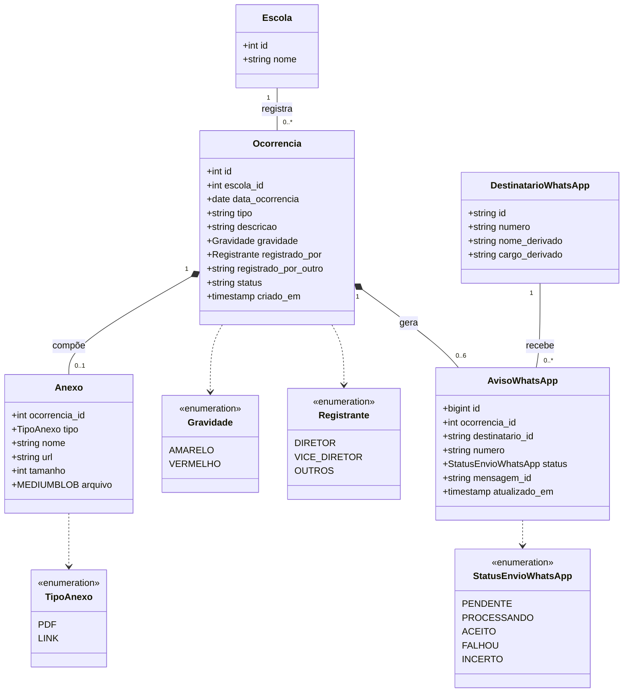
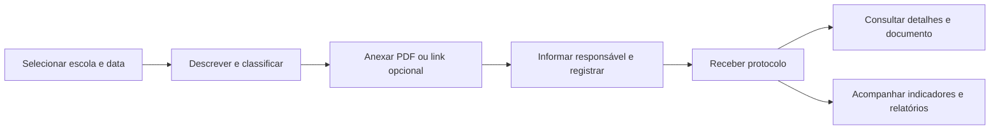
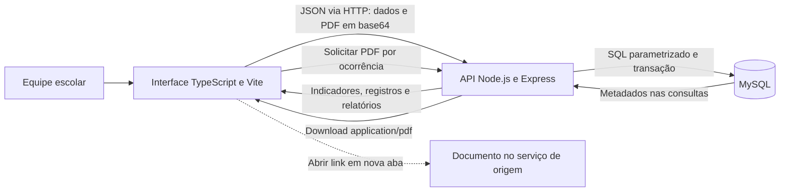
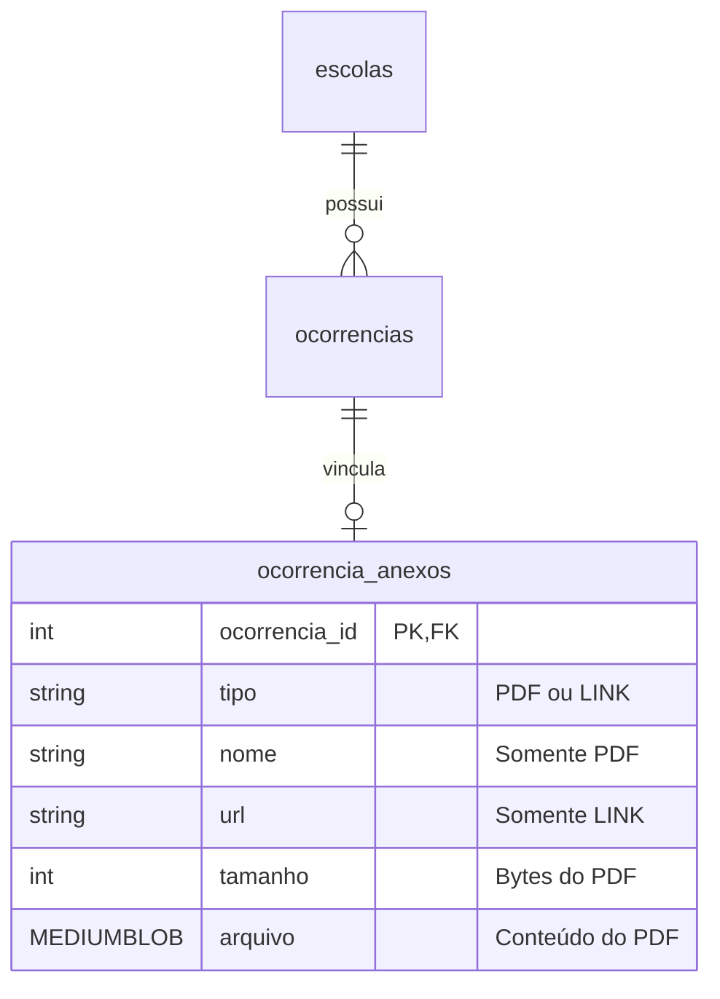

# Conviva SP — uso e arquitetura

A arquitetura simplificada de **registro e disparo ao WhatsApp**, com os seis destinatários configurados pelo ADM, está em [whatsapp.md](whatsapp.md) e na apresentação `/mensageria.html`. O backend persiste a fila junto à ocorrência e envia os avisos pela API da Meta após a gravação. A demonstração não envia mensagens.

A apresentação para o cliente está em [apresentacao.html](../frontend/public/apresentacao.html). Após iniciar o sistema, abra `/apresentacao.html` ou use “Como o sistema funciona” na lateral. A página funciona sem serviços externos e oferece impressão em A4 paisagem ou salvamento em PDF pelo navegador.

Arquivos prontos para compartilhar: [PDF](apresentacao-sistema.pdf) e [imagem PNG](apresentacao-sistema.png).

## Diagrama de classes UML interativo

Abra [uml.html](https://escola-notificacao.pages.dev/uml.html) para apresentar os diagramas de classes e de sequência, selecionar as nove entidades e enumerações, consultar atributos e regras, ajustar zoom e baixar SVG/PNG. O modo apresentação amplia o desenho; selecionar uma classe abre seus detalhes. A impressão gera a apresentação em PDF. O desenho representa o modelo de domínio; o código usa interfaces TypeScript e funções, sem classes JavaScript para cada entidade.

Versões para compartilhar: [classes em PNG](classes-uml.png), [classes em SVG](classes-uml.svg), [sequência em SVG](sequencia-uml.svg) e [apresentação em PDF](classes-uml.pdf). Para regenerar os vetores, execute `npm run docs:uml`.

O contador global de acessos fica fora do modelo das ocorrências: use o Cloudflare Web Analytics, com as [instruções de ativação e acesso do administrador](acessos-cloudflare.md).

## Fluxo de uso

## Aplicação com servidor

## Dados e anexos

- Cada nova ocorrência aceita um anexo opcional: PDF de até 5 MB ou link HTTP/HTTPS de até 2048 caracteres, sem credenciais.
- A descrição aceita até 5.000 caracteres. O painel mostra um resumo de até 300 caracteres; detalhes e exportação CSV preservam o conteúdo completo.
- A API valida extensão, nome, assinatura `%PDF-`, tamanho e codificação do PDF. Isso identifica o formato; não substitui análise antimalware.
- O banco guarda o PDF em `MEDIUMBLOB`. Ocorrência e anexo são inseridos juntos em uma transação; falhas desfazem ambas as inserções.
- Listagens retornam metadados do anexo, sem transferir o PDF. O download consulta o vínculo pelo ID da ocorrência.
- Links abrem na origem. O sistema não baixa nem copia o documento externo; permissões e disponibilidade dependem da origem.
- Registros existentes continuam válidos e exibem “Nenhum documento anexado” quando não possuem anexo.
- `npm run db:init` cria a nova tabela sem apagar registros existentes. O script completo do Workbench contém a mesma estrutura.

## Modo de demonstração

Os registros e os metadados dos anexos ficam em `localStorage`. O conteúdo dos PDFs fica em IndexedDB, evitando a cota menor de localStorage. O sistema só confirma o envio após salvar os dados; falhas de armazenamento mostram erro. Limpar os dados do navegador remove a demonstração. Dados não são compartilhados entre visitantes.

## Escopo atual

O sistema oferece cadastro, consulta dos 200 registros mais recentes, busca, filtros, detalhes, download de PDF, abertura de links, indicadores do histórico, relatório por escola e exportação CSV. Não há autenticação nem controle de acesso. Para implantação com dados reais, esses recursos ainda precisam ser implementados; a demonstração deve usar dados fictícios.
