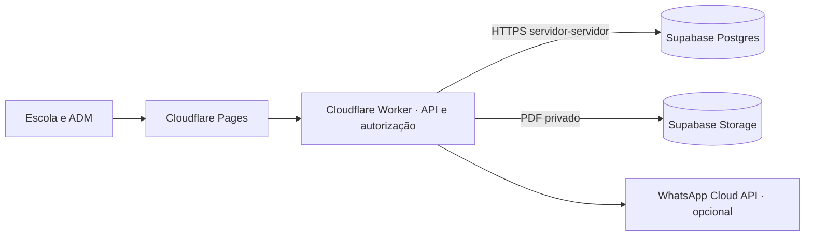

# Migração do banco publicado para Supabase

## Decisão

O usuário escolheu substituir o D1 publicado por Supabase Postgres e manter a interface no Cloudflare Pages. O MySQL local permanece como instalação alternativa de desenvolvimento. A aplicação publicada ainda usa D1 até o fim da migração.

## Arquitetura-alvo

O navegador não recebe a chave `service_role`. O Worker usa credencial de servidor guardada como secret. As tabelas têm RLS habilitado e sem políticas para `anon`/`authenticated`; chamadas ao banco passam pela API protegida.

## Arquivos

- `supabase/migrations/202611190001_schema_inicial.sql`: tabelas, índices, validações e bucket privado.
- `docs/modelo-entidade-relacionamento.svg`: relações lógicas entre escolas, ocorrências, anexos e avisos.

## Configuração necessária

O projeto Supabase deve existir antes do deploy. Configurar secrets/vars no Worker, sem incluí-los no Git:

- `SUPABASE_URL`: URL HTTPS do projeto.
- `SUPABASE_SERVICE_ROLE_KEY`: segredo de servidor do projeto.

Também são necessários o acesso SQL do projeto para executar a migration e uma credencial temporária para importar os dados exportados do D1. Não enviar essas chaves para a interface ou para arquivos versionados.

## Plano de migração

1. Fazer backup lógico do D1 remoto sem publicar o arquivo.
2. Aplicar migration no projeto Supabase e conferir as tabelas e o bucket privado.
3. Implementar acesso a Postgres/Storage pelo Worker; manter autorização ADM no servidor.
4. Importar escolas, ocorrências, metadados de anexos, conteúdo dos PDFs, destinatários e fila de avisos. Preservar IDs e vínculos.
5. Comparar contagens e consultar amostras. Confirmar que PDFs são baixados apenas com ADM.
6. Rodar testes de cadastro, falha transacional, concorrência da fila e autorização antes da troca.
7. Alterar o backend publicado e fazer smoke test de cadastro e consulta ADM.
8. Manter D1 sem exclusão até confirmar estabilidade e backup do novo banco.

## Estado

O esquema-alvo está documentado. A migração e o deploy dependem da URL e da chave de servidor do projeto Supabase e da aplicação da migration SQL. O banco atual continua ativo e os registros ainda ficam no D1.
