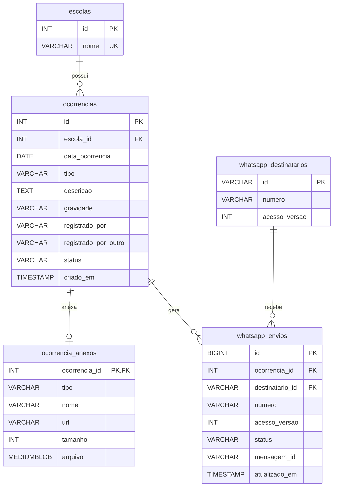

# Modelagem MySQL

> Este é o modelo relacional usado pela instalação Node.js/MySQL local. A produção Cloudflare ainda usa D1. A evolução escolhida é Supabase Postgres; o diagrama abaixo mostra o domínio lógico comum, não afirma que a migração já foi executada.

[Abrir diagrama entidade-relacionamento em SVG](modelo-entidade-relacionamento.svg).

O esquema MySQL guarda escolas, ocorrências, anexos e a fila de avisos. A chave ADM fica em `ADMIN_WHATSAPP_KEY` no ambiente do servidor; nunca fica no banco nem no frontend. A API exige essa chave antes de ler ocorrências, indicadores, relatórios ou PDFs. O cadastro e a lista de escolas continuam públicos.

## Arquivos e inicialização local

- `db/schema.sql`: escolas, ocorrências e anexos.
- `db/seed_escolas.sql`: cadastro das escolas.
- `db/whatsapp.sql`: destinatários e fila de avisos.
- `scripts/init-db.js`: cria o banco se faltar e executa o esquema sem apagar ocorrências.

Configure `.env` com `DB_HOST=localhost`, `DB_PORT=3306`, `DB_USER`, `DB_PASSWORD` e `DB_NAME=escola_notificacao`. Depois execute `npm run db:init`. O comando prepara o banco MySQL local e pode ser repetido.

O acesso ADM não exige tabela de usuários: os administradores compartilham a chave do servidor. Cloudflare usa D1 com o mesmo modelo lógico; o MySQL local não é acessado diretamente pelo Pages/Worker.
