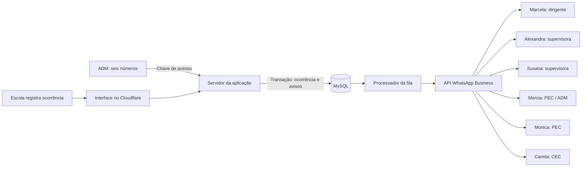

# Registro de ocorrência e avisos pelo WhatsApp

O administrador preenche seis números na aba **Canal direto com a diretoria**: Marcela (dirigente), Alexandra e Susana (supervisoras), Mercia (PEC / ADM), Monica (PEC) e Camila (CEC). Use DDI + DDD + número. Campo vazio desativa o destinatário. Números repetidos são recusados.

O sistema envia avisos automáticos ao WhatsApp pessoal dos seis responsáveis. Cada aviso inclui um link direto para a ocorrência, como `https://seu-sistema/#ocorrencias/123`. Ao tocar no link, o responsável abre os detalhes no navegador. Não há recebimento de respostas, webhook de mensagens ou interface de conversa dentro do sistema.

## Arquitetura simplificada



A apresentação visual em `/mensageria.html` pode ser impressa ou salva em PDF. Arquivos prontos: [PDF](mensageria-arquitetura.pdf), [PNG](mensageria-arquitetura.png) e [prévia da configuração ADM](whatsapp-adm.png). O acesso à configuração exige uma chave ADM no servidor. A chave fica apenas na memória da página e é descartada ao recarregar ou bloquear a configuração. Essa proteção cobre os números e o histórico de mensagens; o cadastro e as consultas existentes continuam sem autenticação.

## Preparar o servidor

1. Execute `npm run db:init`. A migração `db/whatsapp.sql` cria as configurações e a fila sem apagar ocorrências.
2. Gere uma chave aleatória de pelo menos 32 caracteres para `ADMIN_WHATSAPP_KEY`. Entregue-a ao ADM por um canal privado. Não a coloque no frontend.
3. Crie uma conta WhatsApp Business com acesso à Cloud API da Meta, número remetente habilitado e token de servidor com permissão de envio. Cadastre somente destinatários que aceitaram receber os avisos.
4. Submeta um modelo chamado `ocorrencia_registrada`, idioma `pt_BR`, com cinco parâmetros **posicionais no corpo**, nesta ordem: protocolo numérico, escola, data ISO, classificação e link direto da ocorrência.

   ```text
   Nova ocorrência registrada.
   Protocolo: #{{1}}
   Escola: {{2}}
   Data: {{3}}
   Classificação: {{4}}
   Acesse o registro completo: {{5}}
   ```

5. Configure no servidor as variáveis de `.env.example`: `WHATSAPP_TOKEN`, `WHATSAPP_PHONE_NUMBER_ID`, `WHATSAPP_API_VERSION` (uma versão atualmente suportada no formato `vNN.N`), `WHATSAPP_TEMPLATE`, `WHATSAPP_TEMPLATE_LANGUAGE` e `APP_PUBLIC_URL`. Esta última deve conter o endereço HTTPS do frontend conectado ao mesmo backend, sem query string ou fragmento. O link é gerado no servidor; não depende do endereço enviado pelo visitante. Sem um endereço válido, o disparo permanece desativado. Após a aprovação do modelo, defina `WHATSAPP_ENABLED=true` e reinicie o servidor. Nunca use prefixo `VITE_` para segredos.
6. Entre na aba ADM, informe a chave e salve os números. A ativação afeta **novos registros**; ocorrências anteriores não são reenviadas.

Referência de envio: [coleção oficial da Meta para WhatsApp Cloud API](https://www.postman.com/meta/whatsapp-business-platform/documentation/wlk6lh4/whatsapp-cloud-api).

## Cloudflare Pages

O build `build:demo` continua local ao navegador e **não envia mensagens**. Para usar o backend compartilhado, configure o build do projeto Pages a partir da raiz do repositório:

- Comando: `npm --prefix frontend ci && npm --prefix frontend run build`.
- Saída: `frontend/dist`.
- Variável do Pages: `API_ORIGIN=https://dominio-do-backend` (somente a origem, sem caminho).
- Publique o diretório `functions` da raiz junto ao site. O arquivo `functions/api/[[path]].js` encaminha `/api/*` ao servidor Node.js, evitando expor credenciais da Meta e evitando CORS entre navegador e backend.
- O backend Node.js e o MySQL precisam estar publicados e ativos, por exemplo no Railway já previsto no projeto. As credenciais da Meta e a chave ADM ficam **no backend**, e não no Cloudflare ou no bundle do navegador.

Somente copiar `dist` por upload estático não publica Pages Functions. Use integração Git do Pages ou Wrangler com suporte a Functions. Configure os ambientes de produção e de prévia separadamente.

Referências: [Pages Functions](https://developers.cloudflare.com/pages/functions/get-started/), [variáveis e secrets](https://developers.cloudflare.com/pages/functions/bindings/).

## Garantias e limites

- O cadastro não espera chamadas externas. Ocorrência, anexo e avisos são persistidos na mesma transação. Uma falha ao gravar a fila desfaz o cadastro; falha posterior da Meta preserva a ocorrência já salva.
- A fila é processada a cada cinco segundos, em lotes de até seis avisos. A atualização condicional de status impede dois processadores de assumirem o mesmo aviso.
- O aviso envia protocolo, escola, data, classificação e link direto. Descrição, nome do registrante e anexos não são enviados à Meta. O link consulta a ocorrência pelo ID, inclusive quando ela não está mais entre os 200 registros recentes. Os detalhes seguem as mesmas regras de acesso do sistema; o link não cria uma autorização adicional.
- `PENDENTE`: na fila; `PROCESSANDO`: tentativa em curso; `ACEITO`: Meta retornou um ID de mensagem; `FALHOU`: resposta de erro da API; `INCERTO`: timeout, resposta sem ID ou processamento interrompido.
- O painel mostra os últimos 30 avisos. Não há confirmação de entrega ou leitura, pois webhooks ainda não fazem parte desta integração.
- Não há reenvio automático de falhas ou resultados incertos. Consulte o provedor antes de uma intervenção manual para evitar mensagens duplicadas. Processamentos interrompidos há mais de dez minutos passam a `INCERTO` quando o processador volta a rodar.
- Sem integração ativa, o cadastro continua e informa que o envio não está configurado. Com integração ativa e nenhum número preenchido, o cadastro informa ausência de destinatários.
- Salvar números ou ativar o serviço não envia mensagens de teste nem notifica ocorrências antigas.
